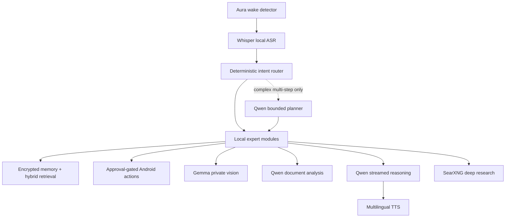
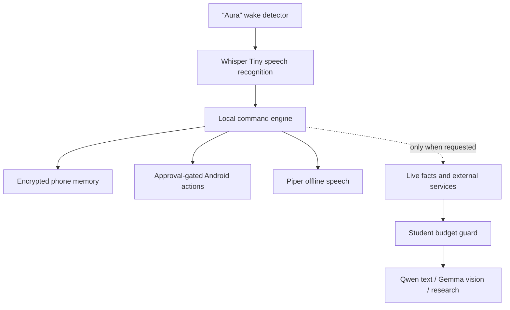

# AURA 0.14 private-first expert architecture

This is a system-level mixture-of-experts pattern: the planner routes work to bounded specialist modules. Training-scale neural MoE, MLA, RLHF/GRPO, or trillion-parameter pretraining are not reproduced on the phone; AURA borrows the architectural principles that are useful at this hardware/budget scale.

## Document RAG

The user chooses a file through Android's document picker. AURA bounds it to 8 MB, sends supported PDF/text/code formats to private Qwen, stores only bounded extracted chunks in encrypted local memory, and retrieves relevant chunks later with lexical + character n-gram + recency scoring. Raw attachment bytes are not persisted by this feature.

## Screen analysis

Each screen capture uses a fresh Android MediaProjection consent result. AURA immediately moves its own task behind the target screen and waits about five seconds before creating the one-shot virtual display, allowing the owner to navigate during screen mirroring.

## Voice path

- sherpa-onnx keyword spotting runs a small English model continuously.
- After it detects “Aura”, the service records one command until silence or the
  25-second limit.
- Multilingual Whisper Tiny transcribes the recording on the phone.
- Piper `en_US-lessac-medium` generates the spoken reply on the phone.
- Android TTS is only an emergency fallback.

The foreground service is started while AURA is visible and keeps a persistent
notification. This follows Android 11’s foreground-microphone restriction.

## Local brain

`LocalButlerEngine` recognizes bounded daily-life intents and returns:

- the assistant’s text/speech;
- zero or more memory writes;
- zero or more typed approval actions.

No prompt or conversation is sent to an LLM. A complex utterance can contain up
to six requests separated with “then”, “and then”, “also”, semicolons, or line
breaks.

## Storage

`SecureStore` uses Android Keystore-backed encrypted preferences. It stores a
bounded set of:

- profile and voice settings;
- 60 recent chat messages;
- 100 preference memories;
- 100 reminders and action-history entries;
- 20 pending approval cards.

Android backup is disabled.

## Student budget guard

Every optional external model path passes through a UTC-day usage ledger in
Android no-backup storage. Text, vision, research and small helper calls have
separate compile-time limits. Localhost endpoints (including laptop Ollama over
ADB reverse) are unmetered. The Modal service independently enforces its own
durable daily limits, request-size caps, one-container ceilings and
scale-to-zero behavior, so a modified client or leaked endpoint cannot silently
create unlimited GPU usage.

## Live information

`KeylessLiveInfoProvider` uses:

- Open-Meteo’s HTTPS geocoding and forecast endpoints;
- Google News RSS, including optional topic searches;
- Wikipedia’s summary/search endpoint and DuckDuckGo Instant Answers.

These calls contain a requested place/topic/question or saved home coordinates,
not chat history, memories, recordings, or a device identity. No API key is
required.

## Safety boundary

Every external or phone-changing action is represented by a typed
`ButlerAction`, validated again by `ActionSafetyPolicy`, and shown for approval.
Calls open the dialer, messages/email open a composer, protected settings use
Android’s permission screen, and orders/bookings open a provider search. Final
submission remains with the user.
